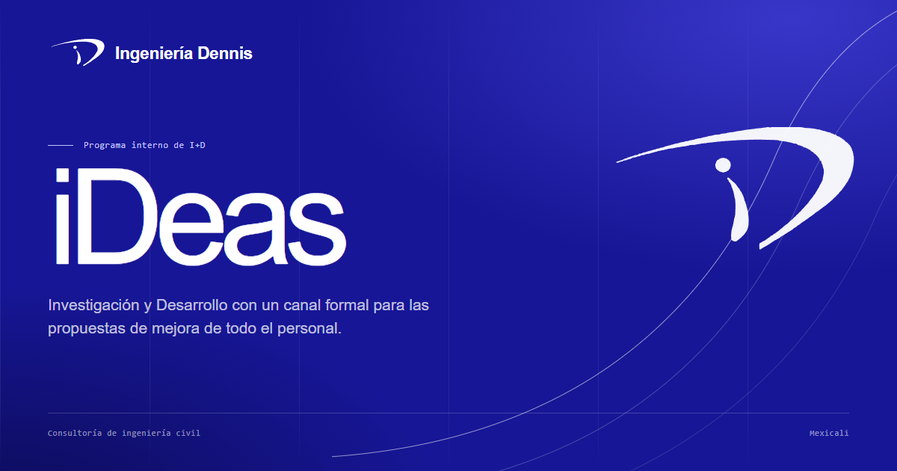

# Portafolio de propuestas de valor — Ingeniería Dennis

Portafolio web colaborativo de la **Meta 4.1** de Gestión de la Innovación: organización, grupos de interés, propuestas de valor y su relación con la innovación. El caso de estudio es **Ingeniería Dennis**, firma de consultoría de ingeniería civil especializada en proyectos de infraestructura a gran escala en Mexicali.

[](https://vercel.com/new/clone?repository-url=https://github.com/Anael19-gg/pagina-innovacion)



## Contenido del portafolio

1. **Organización.** Perfil de la firma, hallazgo principal del diagnóstico y presentación del programa interno de I+D **iDeas**.
2. **Grupos de interés.** Lista de actores internos y externos, revisión de las cinco familias, matriz poder–interés y tres grupos prioritarios.
3. **Propuestas de valor.** Resumen de las tres propuestas y expedientes completos: mapas de empatía para los grupos internos y Value Proposition Canvas para los clientes.
4. **Relación con la innovación.** Cómo iDeas conecta el conocimiento del personal, los recursos de la dirección y la validación de los clientes.

## Revisión de la Meta 4.1

| Criterio | Cobertura |
| --- | --- |
| Identificación y priorización de grupos de interés (30%) | Cinco actores, cinco familias revisadas, matriz poder–interés y tres grupos prioritarios (dos internos y uno externo). |
| Calidad de las propuestas y uso de herramientas (30%) | Tres propuestas de valor; mapas de empatía para los grupos internos y VPC para los clientes. |
| Vinculación con la innovación organizacional (20%) | Sección 04 con el programa iDeas, los roles del ecosistema y el flujo hallazgo → iDeas → propuestas → innovación continua. |
| Trabajo colaborativo y presentación (20%) | Sitio navegable, responsive, accesible, instalable como PWA e imprimible como portafolio PDF. |

### Datos de la entrega

- **Tamaño:** Pequeña empresa.
- **Integrantes:** Anael Ramos Morales, Pablo Alejandro Prado Pimentel y Melany Tapia Morales.

## Estructura

```
index.html              Portafolio principal
offline.html            Respaldo sin conexión para la PWA
favicon.ico             Icono del navegador
css/styles.css          Diseño, componentes y estilos de impresión
css/fonts.css           Tipografías locales
js/main.js              Revelados, impresión, instalación PWA y estado de conexión
sw.js                   Service worker
manifest.webmanifest    Manifiesto de la aplicación
vercel.json             Encabezados para el despliegue en Vercel
assets/                 Logotipo, iconos, tipografías e imagen para compartir
```

## Desarrollo local

El sitio no requiere compilación. Para probar la PWA y el service worker hace falta servirlo por HTTP en localhost:

```bash
npx serve .
```

También funciona con cualquier servidor estático, por ejemplo:

```bash
python -m http.server 4173
```

## Despliegue en Vercel

1. Importa el repositorio en Vercel.
2. Selecciona la plantilla **Other**.
3. Deja vacío el comando de compilación y usa la raíz del proyecto como directorio de salida.

Vercel servirá `index.html` en la raíz y los encabezados de `vercel.json` se aplicarán automáticamente.

## Instalar la PWA

Los botones **Instalar aplicación** de la portada y del pie abren la instalación nativa cuando el navegador la ofrece. Si no está disponible —por ejemplo, en iPhone o iPad— muestran una guía con los pasos para Chrome, Edge, Android e iOS. La aplicación queda instalada con el nombre **Dennis 4.1**.

## PWA e impresión

- El service worker precarga la página, estilos, tipografías e iconos.
- Las visitas usan red primero y caché como respaldo; los recursos estáticos usan caché con actualización en segundo plano.
- Si se cambian archivos cacheados, actualiza `CACHE_NAME` en `sw.js` para invalidar la versión anterior.
- **Imprimir portafolio** abre una guía rápida y luego el diálogo de impresión. Para guardar el PDF: elige **Guardar como PDF**, desactiva **Encabezados y pies de página**, usa **A4** y escala **100%**. El diseño de impresión ya incluye portada, secciones y datos de entrega.
